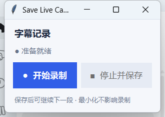

# Save Live Captions

**Tired of losing live captions on Windows?**  This is a simple tool to save the content of live captions! The saved text document is like following:
>

###  Features

---
- ✨Save live captions to a text file.
- 😃Minimalist floating dashboard.
- **😎Choose a save folder and tune capture stability in `src/function/config.py`.**

###  Installation
### Option 1: Quick Start (Executable)
You can download the latest version from the [Releases](../../releases) page.

> [!IMPORTANT]
> **Note on Antivirus Alerts:** If you encounter a malware warning for the `.exe` file, it is likely a **false positive** due to the lack of a digital signature. If you worry about this, try option 2 as follows. 

### Option 2: Run from Source (Recommended for Security)
If you prefer to run the code directly, follow these steps in your bash/PowerShell/cmd:

1. **Clone this repo**:
   ```bash
   git clone https://github.com/lyclycNSP/SaveLiveCaptions.git
   ```
2. **Install dependencies**:
   ```bash
   pip install -r requirements.txt
   ```
3. **Run the tool**:
   ```bash
   python src/main.py
   ```
   > **Good News, You can now edit the `src/function/config.py` to modify the quality of saving on your own.**

### Guidelines

---

1. Open **Windows Live Captions** with **Win + Ctrl + L**, then run the tool. The autostart version opens Live Captions only if it is not already running. The dashboard has a taskbar entry and a standard Windows title bar: drag the title bar to move it, or minimize and restore it while recording continues.



2. **● 开始录制** starts capture. **■ 停止并保存** saves pending captions and returns to the ready state. Start again to record the next segment in a separate file without reopening the application.

3. **Start saving:** Choose a save folder. Cancelling the folder dialog uses `~/Documents/captions`. Each session creates a unique UTF-8 TXT file; the dashboard shows its filename. If Live Captions is unavailable or file writing fails, an error appears and you can retry.

   Each recording uses the first successful caption read as a baseline and excludes text already present. Later snapshots save only the new part, including additions to an unfinished old tail. Starting another segment establishes a fresh baseline. Start recording before playing the next segment; the cutoff is the initial read after connecting, rather than an exact audio timestamp.

4. **Save or exit:** After stopping, wait for the saved status before starting the next segment. Find `YYYY-MM-DD_HH-MM-SS_captions.txt` in the chosen folder (a numeric suffix is added if needed). Use the title bar close button or **Alt + F4** to exit. Closing during recording asks for confirmation: cancel to continue, or confirm to save and exit. A save failure displays an error and keeps the window open. **Esc** does not stop or exit the application.


## 修复与验证

本地修复了上游 PR #21 的小数拆句与 #22 的数字归一化问题，以及字幕顺序、中文/短句漏存、重复内容误删、退出尾句、拖动抖动和后台错误不可见等问题。完整说明及已知限制见 [代码审查记录](docs/code-review.md)。

字幕以出现顺序保存，保留原文；只有当前尾句的保守扩写会更新已保存末行。实时字幕界面采样无法区分“画面未变”和“再次说出完全相同的话”，任意识别改写也可能保留多个版本。

配置：`STABLE_THRESHOLD` 控制稳定观察次数，`MIN_LENGTH` 只限制仍在变化的未完成短句，`SIMILARITY` 限制已保存尾句的更新，`MAX_SAVED_SENTENCES` 限制会话近期记录。完整短句与退出尾句不会因长度被过滤。

运行回归检查（Python 3.11，Windows）：

```powershell
python -m unittest discover -s tests -v
```

## License

This project is licensed under the MIT License.


